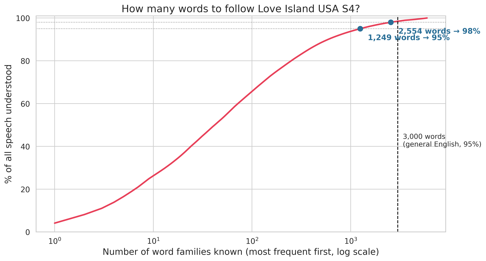

# How simple is the language on *Love Island USA*?

A corpus study of all 38 episodes of *Love Island USA* season 4: vocabulary load, word frequency, readability, lexical diversity, part of speech and sentiment, from 224,815 words of subtitle transcripts.

[Live site](https://lyhjeremy.github.io/love-island-lexical-analysis/) · [Write-up](https://lyhjeremy.github.io/love-island-lexical-analysis/overview/) · [Paper (PDF)](V4/LoveIsland_LexicalAnalysis_V4.pdf)

Design and copy follow [these standards](https://github.com/lyhjeremy/lyhjeremy/blob/main/DESIGN_STANDARDS.md).

## Results

- About **1,250 word families cover 95%** of all speech in the season, and 2,554 cover 98%. Published estimates for everyday spoken English are about 3,000 families for 95% (Adolphs and Schmitt 2003; Nation 2006).
- The **100 most common words are 61%** of everything said. Word frequency fits Zipf's law with R² = 0.98.
- Flesch-Kincaid puts the dialogue at **grade 2.8** (Flesch Reading Ease 90.2). SMOG reads higher at 6.9. 97.9% of words are on the Dale-Chall list of 3,000 familiar words.
- Lexical diversity (mean MTLD 59.96) has no trend across the season, sentiment is positive in every episode, and adjectives are 8.4% of words.



## Method

- Corpus: subtitle transcripts for the 38 episodes, scraped with Selenium and cleaned to one row per episode.
- Vocabulary load: tokens lemmatized with NLTK's WordNet lemmatizer to approximate word families, ranked by frequency, and read off at 80, 90, 95 and 98% cumulative coverage.
- Word frequency: top-N cumulative share and a Zipf fit (OLS of log frequency on log rank).
- Lexical diversity: TTR, root TTR and MTLD per episode, with Pearson and Spearman tests for a trend across the season.
- Readability: textstat (Flesch-Kincaid, Flesch Reading Ease, SMOG, Dale-Chall).
- Part of speech: NLTK tagger. Sentiment: TextBlob polarity and subjectivity.

Stack: Python, pandas, NumPy, SciPy, NLTK, TextBlob, textstat, matplotlib, seaborn, wordcloud, Selenium. The paper is Markdown converted to LaTeX by `scripts/md2tex.py`.

## Limitations

- One season of one show.
- Subtitles drop overlapping speech, accents and delivery speed, so the coverage figure is a lower bound on how hard the show is to follow.
- Lemmatization merges inflections ("making" to "make") but not derived forms, so word families are approximate.
- The readability formulas were built for written prose and disagree on this dialogue, from grade 3 (Flesch-Kincaid, textstat consensus) to about 7 (SMOG, Dale-Chall).

## How to run

Dependencies (once):

```
pip install pandas numpy scipy nltk textblob textstat wordcloud matplotlib seaborn beautifulsoup4 selenium webdriver-manager
```

A LaTeX install (TeX Live) is needed to compile the PDF.

The analysis scripts read `data/` and write figures and tables to the folder named by `LI_OUTPUT_DIR`. `LI_FIG_DPI` sets resolution (default 400). To regenerate the paper's figures:

```
LI_OUTPUT_DIR="$PWD/V4" python scripts/analyze_love_island.py
LI_OUTPUT_DIR="$PWD/V4" python scripts/analyze_vocab_level.py
```

Rebuild the paper after editing `V4/LoveIsland_LexicalAnalysis_V4.md`:

```
python scripts/md2tex.py            # writes V4/LoveIsland_LexicalAnalysis_V4.tex
cd V4 && pdflatex LoveIsland_LexicalAnalysis_V4.tex && pdflatex LoveIsland_LexicalAnalysis_V4.tex
```

## Repo layout

| Path | What it is |
|---|---|
| `data/love_island_s4_transcripts.csv` | Cleaned transcripts, one row per episode |
| `data/love_island_s4_txt/` | One `.txt` per episode |
| `scripts/scrape_love_island_s4.py` | Selenium scraper |
| `scripts/analyze_love_island.py` | Main analysis: figures 01–10 and tables |
| `scripts/analyze_vocab_level.py` | Vocabulary load and reading level: figures 11–12 |
| `scripts/md2tex.py` | Paper Markdown to LaTeX |
| `V4/` | The paper (`.md` source, `.tex`, `.pdf`), its figures and tables |
| `index.html`, `overview/` | The published pages |

## License

[MIT](LICENSE) © 2026 Jeremy Lee
